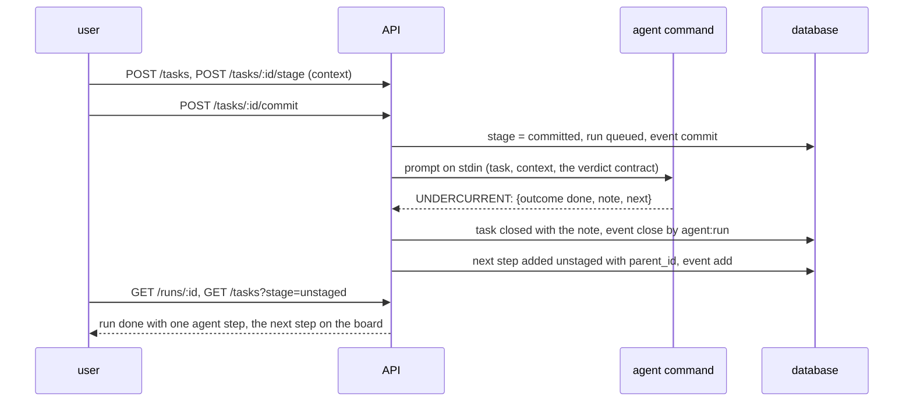
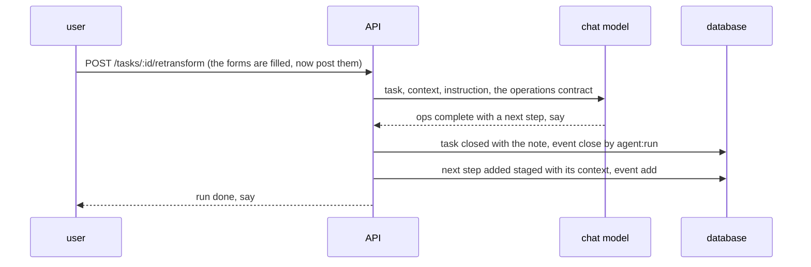
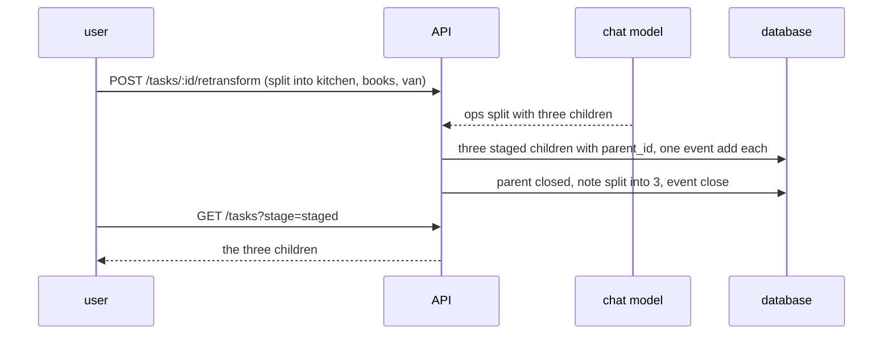
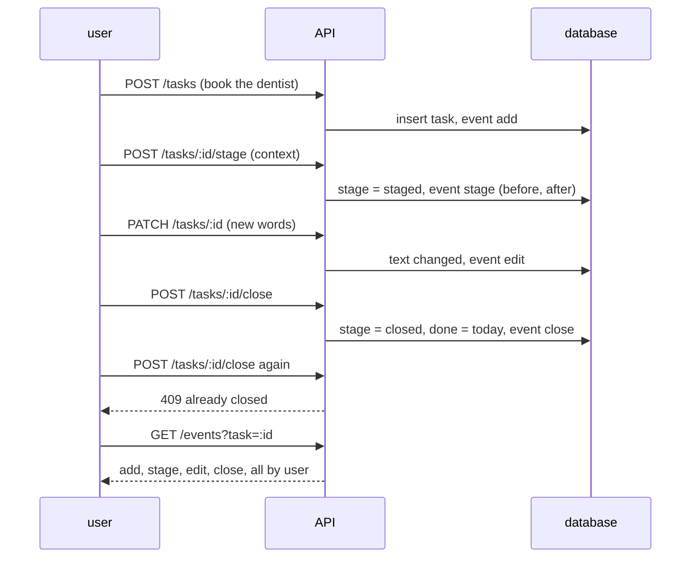
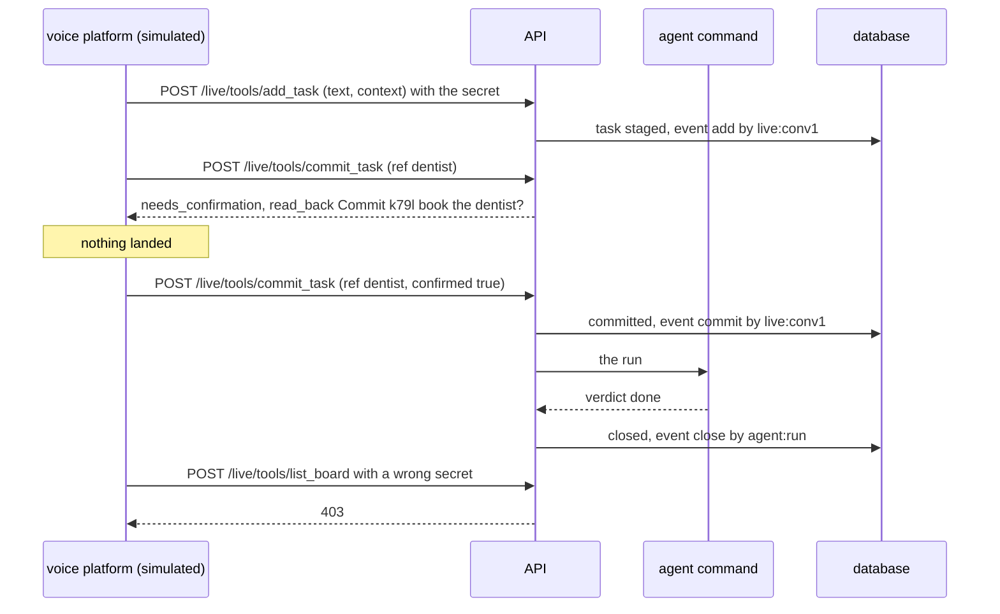
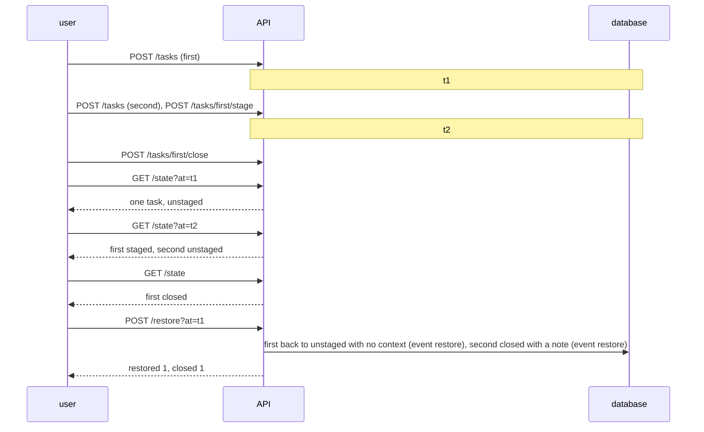
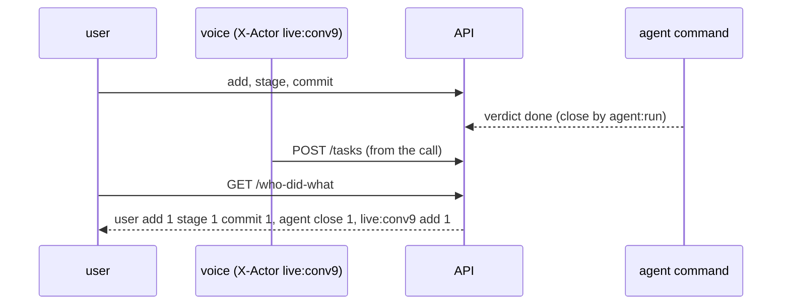
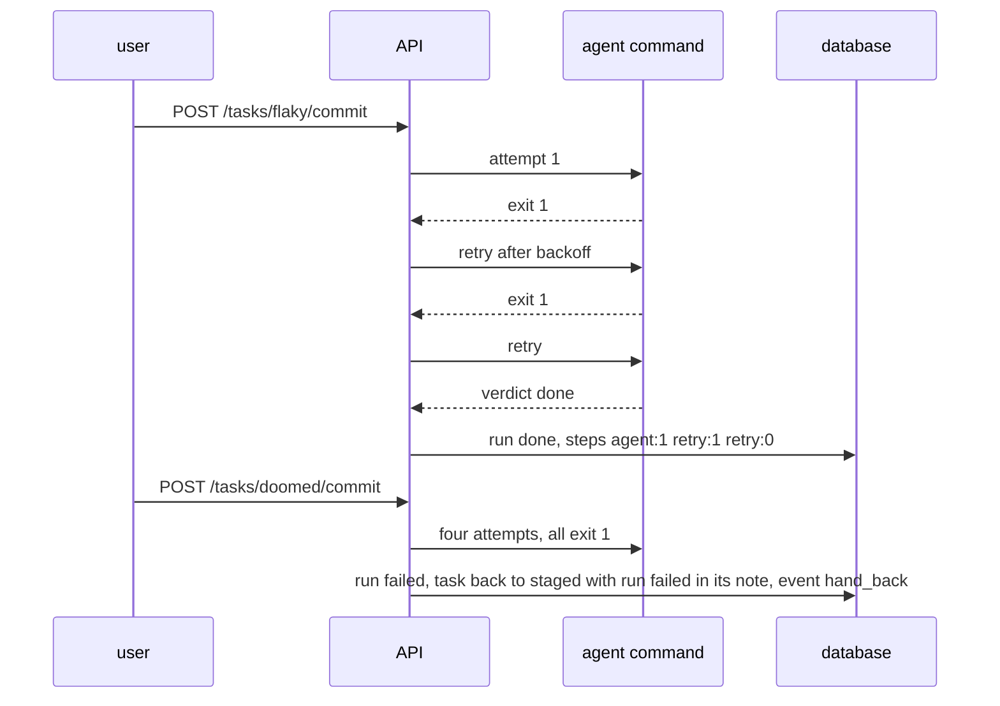
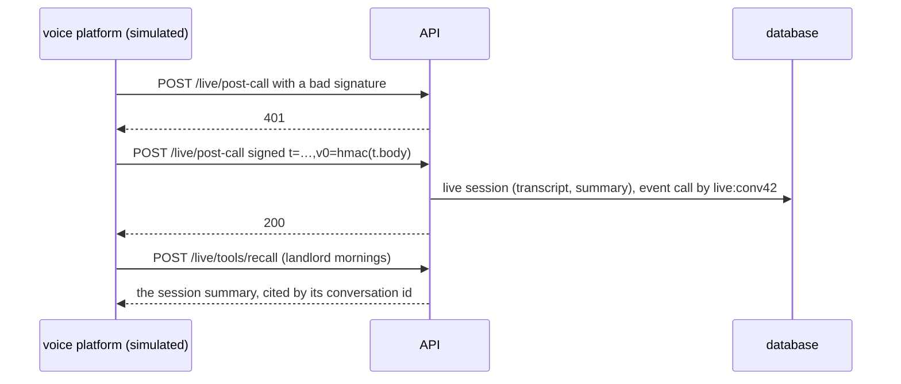

# Testing

Integration tests drive the real HTTP API against a scratch database. The agent command is a
scripted shell counterpart that reads the prompt and prints a scripted verdict (and can fail on
cue); the chat model is an HTTP server answering with scripted operations; the voice platform is
simulated by calling the live endpoints with a real secret and a real signature. Nothing in a test
pretends silently: every counterpart behaves like the real thing on the wire, and every check is on
the database afterwards. Each integration test has one diagram of the flow it holds.

Run: `cd backend && go test ./...`

## I1 · commit runs the agent and yields the next step — `TestI1CommitRunsTheAgentAndYieldsTheNextStep`



## I2 · retransform completes and yields the next — `TestI2RetransformCompletesAndYieldsTheNext`



## I3 · retransform splits into children — `TestI3RetransformSplitsIntoChildren`



## I4 · direct actions leave events — `TestDirectActionsLeaveEvents`



## I5 · live tools read back, then land — `TestI5LiveToolsReadBackThenLand`



## I6 · the agent asks, the owner answers, the run resumes — `TestI6AnAgentQuestionIsAnsweredAndTheRunResumes`

```mermaid
sequenceDiagram
  participant U as user
  participant A as API
  participant G as agent command
  participant D as database
  U->>A: POST /tasks/:id/commit
  A->>G: prompt
  G-->>A: UNDERCURRENT: {outcome needs_you, question which card}
  A->>D: run needs_you with the question, event ask; task stays committed
  U->>A: POST /runs/:id/answer (the business one)
  A->>D: step answer, event answer
  A->>G: prompt with YOU ASKED and THE OWNER ANSWERED
  G-->>A: UNDERCURRENT: {outcome done, note}
  A->>D: task closed, run done with three steps
```

## I7 · time travel and restore — `TestI7StateAtAMoment`



## I8 · who did what — `TestI8WhoDidWhat`



## I9 · bounded retries, then hand back — `TestI9BoundedRetriesThenHandBack`



## I10 · the post-call webhook feeds recall — `TestI10PostCallWebhookFeedsRecall`



## I11 · a committed call task dials and leaves review notes — `TestI11CommittedCallTaskDialsAndLeavesReviewNotes`

The task says call and names a phone number, so the run is a call; a number without a call verb goes
to the agent as usual. Dial is a scripted counterpart here (a fake
REST server keyed by the number); `TestDialLiveCall` places one real call when `DIAL_LIVE_TEST=1`
and `DIAL_LIVE_TO` are set, and is skipped otherwise.

```mermaid
sequenceDiagram
  participant U as user
  participant A as API
  participant P as Dial
  participant M as chat model
  participant D as database
  U->>A: POST /tasks/dentist/commit  (text names +1415…)
  A->>P: POST /api/v1/calls  to, fromNumber, outboundInstruction = the task and its context, Idempotency-Key = run id
  P-->>A: call queued
  A->>P: GET /api/v1/calls/{id}  until Terminated and the transcript has landed
  P-->>A: completed, 83s, transcript
  A->>M: summarize the transcript
  M-->>A: one sentence
  A->>D: event call; task closed with the summary; "Review call notes: …" unstaged with the transcript as context; run done, step call exit 0
  U->>A: POST /tasks/landlord/commit  (text names +1415…99)
  A->>P: place, poll
  P-->>A: no-answer
  A->>D: event call, task back to staged with "the call was not completed: no-answer", event hand_back, run failed, no review task
  U->>A: POST /tasks/plumber/commit  ("text … +1415…77", no call verb)
  A->>A: the agent command, as for any task
```

## I12 · one agent works the queue; a question parks the task — `TestI12OneAgentWorksTheQueueAndAQuestionParksTheTask`

The only test on the real queue (the others run the agent in the request). The scripted agent's
lines are consumed in order, which is how the test knows the gym was taken first.

```mermaid
sequenceDiagram
  participant U as user
  participant A as API
  participant Q as the one agent (queue)
  participant G as agent command
  participant V as voice agent
  U->>A: POST /tasks/gym/commit, POST /tasks/weather/commit
  A->>Q: run 1, run 2 queued in that order
  Q->>G: run 1 · gym
  G-->>Q: needs_you "Did you go to the gym?"
  Q->>A: run 1 parked, gym stays committed; next
  Q->>G: run 2 · weather
  G-->>Q: done "sunny, 61°F"
  Q->>A: weather closed with the note
  V->>A: GET /live/config — the board text ends with the waiting question
  U->>A: POST /runs/1/answer "yes, this morning"
  A->>Q: run 1 queued again
  Q->>G: run 1 with the answer
  G-->>Q: done "the owner went"
  Q->>A: gym closed
```

## Smaller tests

- The demo set takes its stages from the migration: 16 unstaged, 22 staged, 4 closed — `TestTheDemoSetTakesItsStages`
- Planned: `state(at)` on an empty log; the Keewano payload builder emits only registered ids
  (needs no key — `Payload` is exported for it); legal transitions only.
