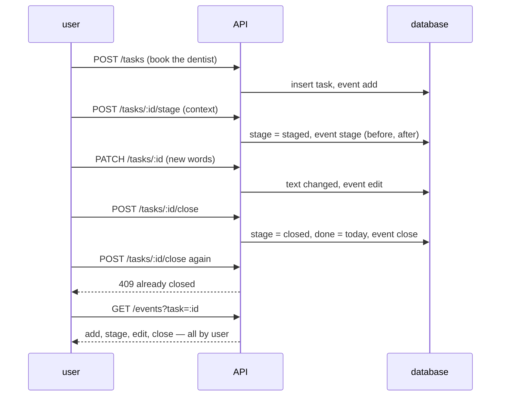

# Testing

Integration tests drive the real HTTP API against a scratch database seeded with the demo set.
Agents, phones and the voice platform are replaced by scripted or simulated counterparts that
behave like the real thing on the wire; nothing in a test is faked silently. Each integration
test has one diagram of the flow it holds. Smaller tests get a line.

Run: `cd backend && go test ./...`

## Integration tests

### I4 · direct actions leave events — `TestDirectActionsLeaveEvents` ✓

### Planned

| # | Flow | Holds |
|---|---|---|
| I1 | stage → commit → run completes → next step unstaged | closed with a note, a child with `parent_id`, events in order |
| I2 | retransform: half done, the rest is X → complete and yield | old closed, new staged with the given context |
| I3 | retransform: split into three | three staged children, parent closed |
| I5 | live: add and commit by voice → read-back → confirmed | first call returns the read-back, the second lands; `live:` actor |
| I6 | run asks → answer → resumes → done | `needs_you` then `done`, the answer in the steps |
| I7 | time travel: six actions, three moments | each board matches its snapshot |
| I8 | who-did-what over a mixed day | counts per actor |
| I9 | failure injection: the phone tool fails twice then succeeds | bounded retries; a fourth failure fails the run and hands the task back |
| I10 | post-call webhook → live session → recall | a later question returns the summary with its citation |

## Smaller tests

- The demo set takes its stages from the migration: 16 unstaged, 22 staged, 4 closed — `TestTheDemoSetTakesItsStages` ✓
- An unbuilt endpoint says so with 501 rather than pretending — `TestUnbuiltEndpointsSaySo` ✓
- Planned: legal transitions only; `state(at)` on an empty log; a bad webhook signature is rejected; the Keewano payload carries only registered ids.
