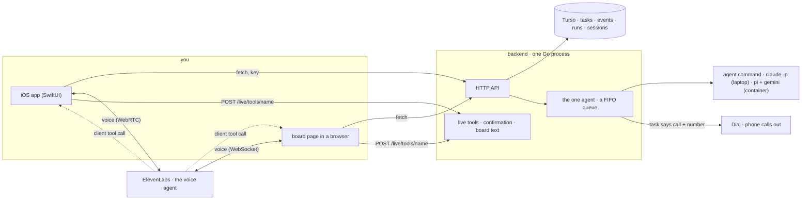
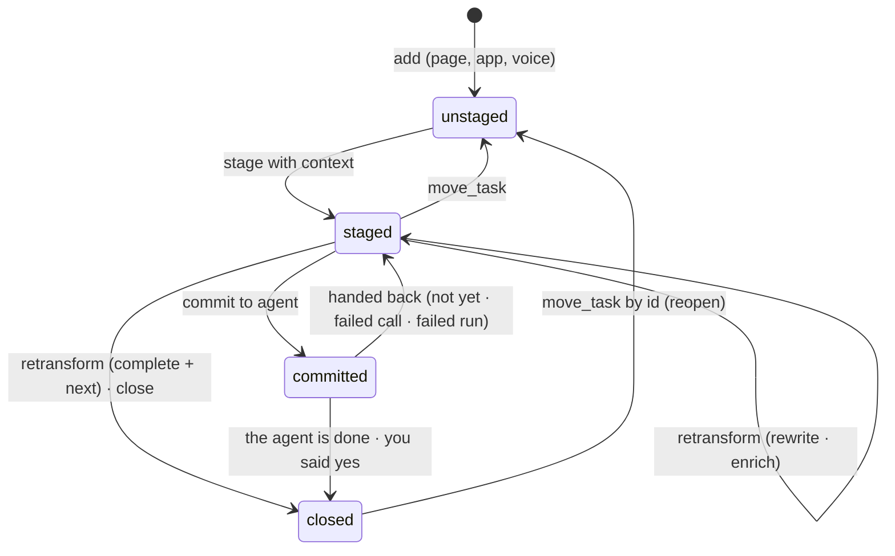
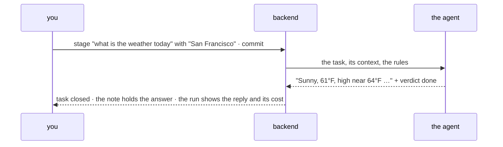
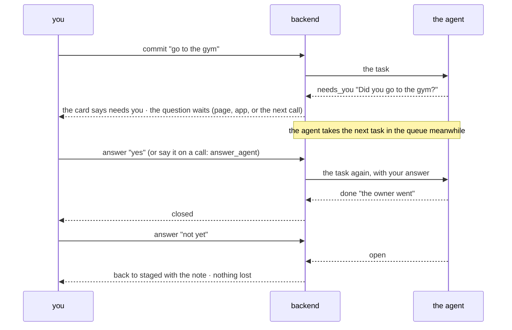
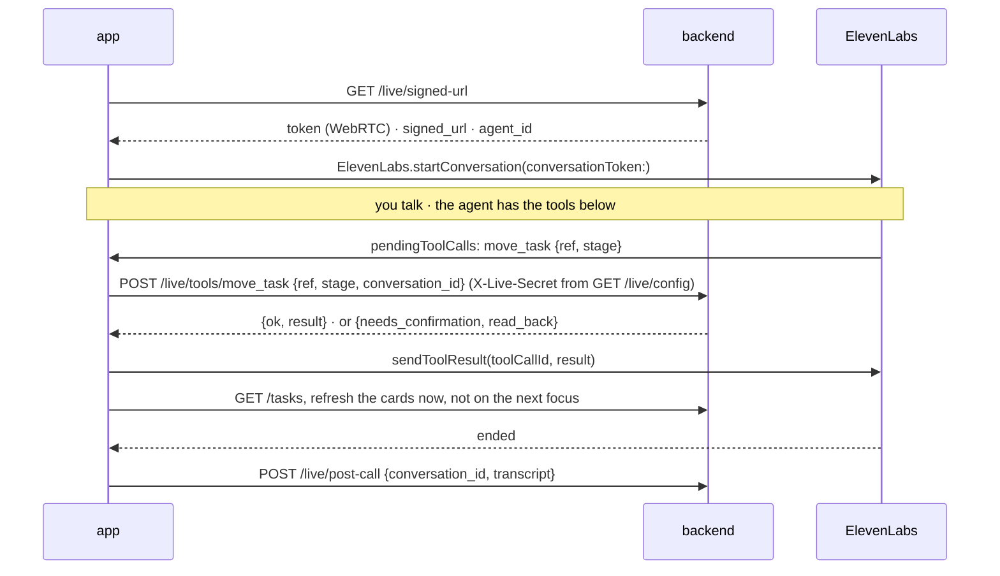

# What's done, how the app plugs in, and what to try

A short map for trying undercurrent from the phone. Everything here is built and tested unless a
line says otherwise. Backend details: `backend/API.md`; the test-by-test diagrams: `TESTING.md`;
the app spec: `MOBILE_APP.md`.

## The shape of it



Two things to hold on to:

- **The backend owns everything that changes the board.** The voice agent runs on ElevenLabs, but
  every tool it calls is executed by the backend, and key actions need a confirmed second call.
- **The board is one.** The laptop backend and the Railway one read the same Turso database, so the
  phone, the page and a call all see the same tasks.

## What's done

| Area | State |
|---|---|
| Board: unstaged → staged → committed → closed, add, edit, close, retransform (rewrite · enrich · split · complete + next) | done, on the page and the API |
| Every action is an event: the board at any moment (`GET /state?at=`), restore, who-did-what | done; the page's slider covers the last 50 actions, `GET /events?limit=20` is for the app's sidebar |
| The agent: one secretary, one queue; does what it can from the machine, asks "did you do it?" for the rest; never restructures the board | done, verified live ("what is the weather today" → answer in 17 s; "go to the gym" → "Did you go to the gym?") |
| A question parks the task, the next item is taken; the answer re-queues it; the queue survives a restart | done (test I12) |
| Calls out through Dial for a committed task that says *call* and names a number; the transcript comes back as "Review call notes" | built against a scripted Dial (I11); the one real call waits for the Dial signup |
| The voice agent: created and synced from `elevenlabs/agent.json`, ten client tools, the whole board handed over at call start, open questions at the end of it, `move_task` by voice | done; one real call verified from the page |
| Transcript kept as a session with a one-line summary; recall across board, runs, calls and coding conversations | done |
| Keewano forwarder (typed events) | built, off until an SDK-type key |
| Shared dev backend on Railway, keyed, direct deploy with `./deploy.sh` | up and verified; optional, the laptop backend is enough |
| Twelve integration tests, one diagram each | green |

## The lifecycle



## Commit to agent: the two things it does

The same button, two behaviours, decided by the agent from the task's words.

**It can do it from the machine → it does, and the note is the answer.**



**Only you can do it → it asks, and your answer decides.**



A question never blocks the queue: with two commits, the first can ask while the second completes.

## The call, from the phone

Prannay's app starts the conversation itself with the ElevenLabs Swift SDK over WebRTC, using a
token the backend mints. That is right. What the backend expects on top of it:



The tools the agent has, and what they do to the board: `list_board`, `add_task`, `stage_task`
(context), `move_task` (unstaged or staged; reopens a closed task by id), `commit_task`,
`retransform`, `edit_task`, `close_task` (these four read back first, then act on `confirmed`),
`answer_agent` (your reply to a waiting question), `recall`.

### The one gap that matters for the phone

The agent's tools are **client tools**: ElevenLabs hands each call to the device that started
the conversation and waits up to 60 s for the result. The page does this; the app does not yet
(`LiveSession.swift` starts the conversation and shows the transcript, but never reads
`conversation.$pendingToolCalls`). Until it does, the agent can talk about the board but cannot
change it from a phone call. Two ways out:

| | What | Who | Time |
|---|---|---|---|
| **B · the designed path** | in `LiveSession`, `for await calls in conversation.$pendingToolCalls.values`: for each, POST its parameters plus `conversation_id` to `/live/tools/<name>` with `X-Live-Secret` (from `GET /live/config`), return `result` (or the `read_back` sentence, or `"ERROR: …"`) with `sendToolResult`, then refresh the board. The page's `runTool` in `backend/internal-web-ui/index.html` is the reference | Prannay | ~40 lines of Swift |
| **A · zero app change** | switch the ten tools to webhook tools pointed at the Railway backend (it is public and keyed, so no tunnel), with the secret and the key as request headers. Calls then change the board whichever device started them | me, on request | ~20 lines of Go + a sync |

The `cloudflared` + `PUBLIC_URL` instructions in `mobile-app/README.md` are from before the client
tools and are obsolete either way.

Smaller gaps, in order: send `Authorization: Bearer <key>` when the backend has one (only the Railway
backend does; the laptop one is open); post the transcript at the end of a call (`/live/post-call`),
so the call shows up in recall and who-did-what; a time-travel sidebar on `GET /events?limit=20` →
`GET /state?at=`.

## Running it for a try

```sh
# the backend, on the laptop, against the shared board (reads ../.env; PORT there, 8787 by default)
backend/scripts/serve.sh
# or a throwaway board with the demo set, on :8788, for breaking things
backend/scripts/serve-local.sh

# the app: Settings → backend URL = http://<this machine>.local:<PORT>, same Wi-Fi
# or the Railway backend (needs the key header in the app first): URL and key are in ../.env as
# RAILWAY_BACKEND_URL / RAILWAY_UNDERCURRENT_API_KEY
```

The page at the same URL is the second window onto the same board: keep it open on the laptop
while you use the phone, and watch cards move.

## What to try, in order

| # | Do | Expect |
|---|---|---|
| 1 | Add "what is the weather today", stage it with "San Francisco", commit | within ~20 s the card is closed; open it: the note is the forecast; the run shows the agent's reply and its cost |
| 2 | Commit "go to the gym" (it is staged in the demo set) | the card says **needs you: Did you go to the gym?**; answer *yes* → closed; answer *not yet* → back to staged with the note |
| 3 | Commit two tasks back to back, one that asks and one the agent can do | the first parks with its question while the second completes; the queue is one agent, in order |
| 4 | Retransform a staged task: "split this into three" · "the first half is done, the rest is X" | three staged children and the parent closed · a closed task and a new staged one |
| 5 | Move a card between unstaged and staged; close one; reopen it from the closed list | each is one request, no agent; who-did-what lists them |
| 6 | Time travel: pick an earlier action | the board as it was right after it, read-only |
| 7 | Call: "put *call the plumber about the gate* on the board" | added at once (no confirmation); on the phone this needs the client-tools gap closed, on the page it works today |
| 8 | Call: "move *build the bookshelf* to done" | the agent reads back "Close 9sz9 'Build the bookshelf'?", you say yes, the card leaves the board |
| 9 | Call, with a question waiting: say "yes, I went" when it asks about the gym | the task closes; `answer_agent` carried your reply |
| 10 | With a Dial key: stage "call +1… and ask whether Tuesday 9am works", commit | the backend places the call; afterwards the task is closed with a summary and "Review call notes: …" appears unstaged with the transcript |

Numbers 1–6 and 8–9 on the page need nothing from anyone. For 7–9 on the phone, pick A or B above.
Number 10 needs the Dial signup (`npm install -g @getdial/cli`, `dial auth login …`).
